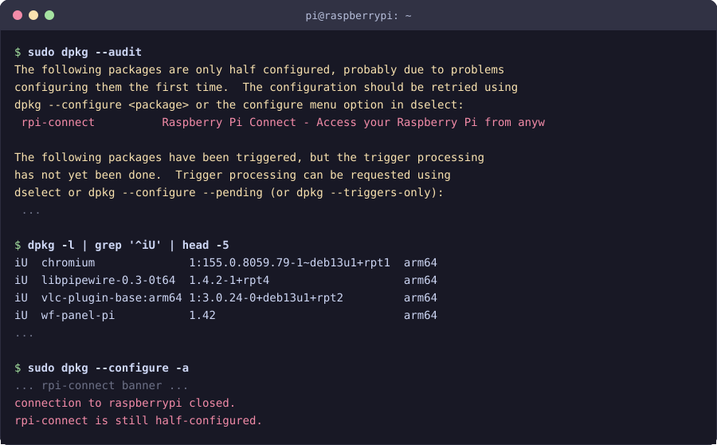
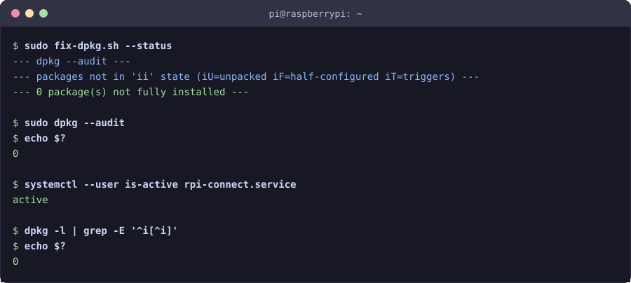
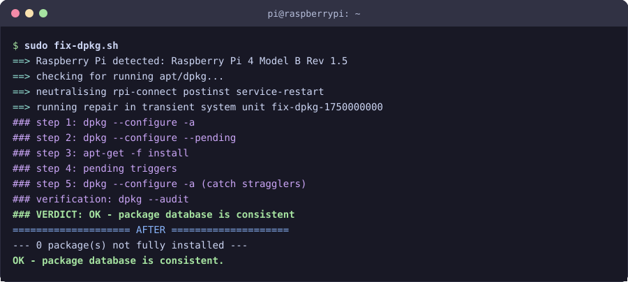
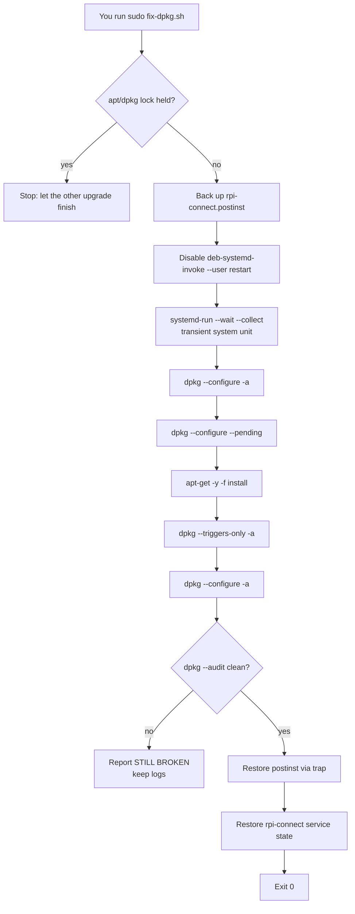

# raspberrypi-dpkg-repair

**Repair a Raspberry Pi package database that is stuck in “half configured” /
“unpacked but not configured” state — even when `dpkg --configure -a` keeps
failing.**

[](#requirements)
[](LICENSE)
[](#requirements)

<sub>An original project by <a href="https://github.com/okuri71">okuri71</a>, implemented with <a href="https://opencode.ai">OpenCode</a>.</sub>

| Before | After |
| :---: | :---: |
|  |  |

---

## Table of contents

- [What is this?](#what-is-this)
- [Who is it for?](#who-is-it-for)
- [Symptoms](#symptoms)
- [Why it happens](#why-it-happens)
- [What the script does](#what-the-script-does)
- [Requirements](#requirements)
- [Quick start](#quick-start)
- [Screenshots / walkthrough](#screenshots--walkthrough)
- [Logs](#logs)
- [Safety and rollback](#safety-and-rollback)
- [Verifying the fix](#verifying-the-fix)
- [Troubleshooting / FAQ](#troubleshooting--faq)
- [How it works](#how-it-works)
- [Project layout](#project-layout)
- [Privacy](#privacy)
- [Contributing](#contributing)
- [License](#license)
- [Credits](#credits)

---

## What is this?

`fix-dpkg.sh` is a single, self-contained Bash script that repairs a Raspberry
Pi whose `dpkg`/`apt` database is wedged. It is aimed at the specific failure
where:

- `sudo dpkg --audit` reports one or more packages as **half configured**;
- dozens of packages are stuck in `iU` (“install ok unpacked”);
- `sudo dpkg --configure -a` looks like it runs but changes nothing;
- `apt` refuses to do anything because “dpkg was interrupted”.

The script works around the two bugs that usually cause this state, runs the
repair **detached from your terminal** so it cannot be killed halfway through,
then verifies that the database is consistent again.

It is intentionally small and readable: no daemon, no dependencies beyond the
tools already present on Raspberry Pi OS, and no telemetry. The only network
traffic is the SSH connection you start yourself plus whatever `apt` needs to
resolve dependencies.

## Who is it for?

You will probably find this useful if:

- you run **Raspberry Pi OS** (Debian 12 “bookworm” or 13 “trixie”) on a Pi
  with `systemd`;
- an upgrade was interrupted (reboot, power loss, closed SSH session, killed
  terminal) and left the package database inconsistent;
- you use **Raspberry Pi Connect** and your remote shell keeps dying while
  `dpkg` is configuring `rpi-connect`;
- you want a repeatable, inspectable fix instead of blindly deleting lock
  files or re-flashing the SD card.

It is **not** a general-purpose “fix my Linux” script. It targets Debian-style
`dpkg`/`apt` systems and the `rpi-connect` post-install bug in particular.

## Symptoms

Typical output on an affected Pi:

```console
$ sudo dpkg --audit
The following packages are only half configured, probably due to problems
configuring them the first time.  The configuration should be retried using
dpkg --configure <package> or the configure menu option in dselect:
 rpi-connect          Raspberry Pi Connect - Access your Raspberry Pi from anyw

The following packages have been triggered, but the trigger processing
has not yet been done.  Trigger processing can be requested using
dselect or dpkg --configure --pending (or dpkg --triggers-only):
 ...
```

And a large number of unpacked packages:

```console
$ dpkg -l | grep '^iU' | head
iU  chromium              1:155.0.8059.79-1~deb13u1+rpt1  arm64
iU  libpipewire-0.3-0t64  1.4.2-1+rpt4                    arm64
iU  vlc-plugin-base:arm64 1:3.0.24-0+deb13u1+rpt2         arm64
iU  wf-panel-pi           1.42                            arm64
...
```

`sudo dpkg --configure -a` appears to run, prints the `rpi-connect` banner, and
then leaves `rpi-connect` half-configured again — every single time. If your
shell is a Raspberry Pi Connect session, the terminal may simply disappear.

## Why it happens

Two failures stack on top of each other.

### Bug 1 — an upgrade interrupted before it finished

A `sudo apt full-upgrade -y` was started, unpacked many packages, and then the
machine rebooted (or lost power, or the session was killed) before `apt` could
configure them. `/var/log/apt/history.log` shows a `Start-Date:` with no
matching `End-Date:`:

```text
Start-Date: 2026-01-01  00:07:03
Commandline: apt full-upgrade -y
                                  <-- no End-Date: apt never finished
```

That is what leaves the mass of `iU` packages behind: `apt` never got to the
configure phase.

### Bug 2 — `rpi-connect` kills `dpkg` mid-postinst

`/var/lib/dpkg/info/rpi-connect.postinst` ends with something like:

```sh
if [ "$1" = "configure" ] || ... ; then
    if [ -z "${DPKG_ROOT:-}" ] && [ -d /run/systemd/system ]; then
        ...
        deb-systemd-invoke --user restart 'rpi-connect.service' \
            'rpi-connect-wayvnc.service' 'rpi-connect-signin.path' >/dev/null 2>&1 || true
    fi
fi
```

A Raspberry Pi Connect **remote shell is a child of `rpi-connect.service`**.
So when `dpkg` configures `rpi-connect`, its post-install script restarts the
service that hosts your shell:

1. `sudo dpkg --configure -a` configures `rpi-connect` → runs its postinst.
2. The postinst calls `deb-systemd-invoke --user restart rpi-connect.service`.
3. `systemd` stops the service → kills every process in that cgroup, including
   the shell that is running `dpkg`.
4. The pty closes → `dpkg` receives `SIGHUP` → **`dpkg` dies mid-postinst**.
5. `rpi-connect` is never marked installed → stays `iF` half-configured.
6. Step 1 repeats forever.

The signature is visible in `journalctl` and `/var/log/dpkg.log`:

```text
systemd[850]: rpi-connect.service: Failed to kill control group
    /user.slice/user-<uid>.slice/user@<uid>.service/app.slice/rpi-connect.service,
    ignoring: Operation not permitted
systemd[850]: Stopping rpi-connect.service - Raspberry Pi Connect...
```

```text
2026-01-01 00:15:00 configure rpi-connect:arm64 2.14.0 <none>
2026-01-01 00:15:00 status half-configured rpi-connect:arm64 2.14.0
2026-01-01 00:15:22 startup packages configure        <-- retried, same result
2026-01-01 00:15:22 configure rpi-connect:arm64 2.14.0 <none>
2026-01-01 00:15:22 status half-configured rpi-connect:arm64 2.14.0
```

`half-configured` with **no** following `status installed` is the signature of a
process that was killed, not of a script that returned non-zero. The postinst
exits `0` when run by hand; the script itself is not the problem.

## What the script does

`fix-dpkg.sh` neutralises both halves of the problem:

| Step | Purpose |
| --- | --- |
| Lock probe (`flock` on the dpkg/apt locks) | Refuses to fight a running `apt`/`dpkg`. |
| Neutralise `deb-systemd-invoke --user restart` in `rpi-connect.postinst` | The restart can no longer take down the operator's shell. The file is syntax-checked and restored by a `trap` on every exit path. |
| Run the repair in a transient **system** unit (`systemd-run --wait --collect`) | The worker lands in `/system.slice/…`, outside `rpi-connect.service`'s cgroup and detached from any tty, so neither a `SIGHUP` nor a service restart can kill it halfway through. |
| `dpkg --configure -a` | Configures everything unpacked or half-configured. |
| `dpkg --configure --pending` | Same thing, belt and braces. |
| `apt-get -y -f install` | Resolves dependencies the interrupted upgrade left missing. |
| `dpkg --triggers-only -a` | Drains the pending-trigger backlog. |
| `dpkg --configure -a` | Catches stragglers. |
| `dpkg --audit` + `dpkg -l` verification | Proves the database is consistent again. |
| Restore `rpi-connect.service`'s original running state | Leaves the desktop as it was. |

Everything the worker prints is teed to `/var/log/fix-dpkg-worker.log`, so the
verdict survives even if your terminal is dropped mid-run.

### One Debian gotcha

`apt-get --triggers-only` is rejected on Raspberry Pi OS:

```text
E: Command line option --triggers-only is not understood in combination with the other options
```

because Debian ships `APT::Get::List-Cleanup "false"`, which `apt` treats as
incompatible with `--triggers-only`. The script uses `dpkg --triggers-only -a`
directly instead.

## Requirements

- **Raspberry Pi OS** (Debian 12 “bookworm” or 13 “trixie”), `arm64` or
  `armhf`.
- A **systemd**-based installation (the fix relies on `systemd-run`; a `setsid`
  fallback exists, but the detached system unit is the safe path).
- `sudo`/root access.
- `bash` 4 or newer.
- For the remote helper scripts: `ssh` and `scp` on your workstation, plus
  key-based auth or an `ssh-agent` (the scripts use `BatchMode=yes`, so they
  will not prompt for a password), and **passwordless `sudo`** on the Pi
  (the scripts call `sudo -n`).

It should also work on other Debian/Ubuntu systems with `dpkg`, but it has only
been tested on Raspberry Pi OS. It is not intended for containers without
systemd.

## Quick start

### Option A — run it on the Pi itself

```bash
git clone https://github.com/okuri71/raspberrypi-dpkg-repair.git
cd raspberrypi-dpkg-repair

# Inspect first: this changes nothing.
sudo ./fix-dpkg.sh --status

# Repair.
sudo ./fix-dpkg.sh
```

If the file is not executable, use `sudo bash fix-dpkg.sh`.

### Option B — deploy it from your workstation over SSH

There is no hard-coded host. You must pass your own `PI_HOST`:

```bash
# Show the Pi's current package state.
PI_HOST=pi@raspberrypi.local ./deploy.sh --status

# Copy + install to /usr/local/sbin/fix-dpkg.sh and show the status.
PI_HOST=pi@raspberrypi.local ./deploy.sh

# Copy + install + run the repair immediately.
PI_HOST=pi@raspberrypi.local ./deploy.sh --run
```

Useful optional variables:

```bash
# Friendly name in the messages (defaults to the host part of PI_HOST).
PI_HOST=user@192.168.1.50 PI_NAME=my-pi ./deploy.sh

# Use a specific private key (default: your ssh config / ssh-agent).
PI_HOST=pi@raspberrypi.local SSH_KEY=~/.ssh/my_pi_key ./deploy.sh
```

`deploy.sh` installs the script to `/usr/local/sbin/fix-dpkg.sh` and also copies
it into the remote user's home directory, so it is available there as well.

### Uninstall

```bash
PI_HOST=pi@raspberrypi.local ./uninstall.sh
```

This removes `/usr/local/sbin/fix-dpkg.sh`, `/var/lib/fix-dpkg`, and the copy in
the remote user's home. It warns you if `rpi-connect.postinst` still carries the
`fix-dpkg.sh: disabled` marker.

## Screenshots / walkthrough

> These are illustrative terminal renderings of the real output, trimmed for
> readability. The exact package names and versions on your Pi will differ.

### 1. Before — the database is broken


### 2. During — the repair runs detached from the terminal



### 3. After — `dpkg --audit` is clean


## Logs

| Path | Contents |
| --- | --- |
| `/var/log/fix-dpkg.log` | The script's own output. |
| `/var/log/fix-dpkg-worker.log` | The detached worker's output plus the `### VERDICT:` line. |
| `/var/lib/fix-dpkg/worker.sh` | The worker script as executed. |

Watch the worker while it runs:

```bash
sudo tail -f /var/log/fix-dpkg-worker.log
```

## Safety and rollback

- **No data is deleted.** The script does not touch your home directory,
  documents, or installed package contents. It configures packages and resolves
  dependencies.
- **It does not run `apt full-upgrade`.** It reports how many upgrades remain
  and leaves that decision to you.
- **It is idempotent.** Running it on a healthy Pi is a no-op.
- **It refuses to run while another `apt`/`dpkg` holds a lock**, so it will not
  fight an upgrade that is still in progress.
- **The modified postinst is restored** by a `trap` on `EXIT`, `INT`, and
  `TERM`, even if the repair fails or you press Ctrl-C.
- **The repair runs outside your shell's cgroup**, so closing the terminal (or
  an `rpi-connect` restart) cannot kill it halfway through.

As with any system-level repair, take a snapshot or at least back up the
package database first:

```bash
sudo cp -a /var/lib/dpkg/status /var/lib/dpkg/status.bak
```

To undo the postinst change manually:

```bash
sudo apt-get install --reinstall rpi-connect
```

Exit codes: `0` = database consistent, `1` = still broken or a preflight
failure. The worker writes a `### VERDICT: OK` or `### VERDICT: STILL BROKEN`
line to its log.

## Verifying the fix

Check the result yourself:

```bash
sudo dpkg --audit                 # should print nothing
dpkg -l | grep -E '^i[^i]'        # should print nothing
sudo apt-get -f install           # should be a no-op
```

The repository also contains a test harness. The local checks need no Pi:

```bash
./tests/run-tests.sh --local
```

The full suite runs against a real Pi and **deliberately breaks its package
database** before repairing it. Install the script on the Pi first
(`./deploy.sh`), then run:

```bash
PI_HOST=pi@raspberrypi.local ./tests/run-tests.sh
```

> **Warning:** the remote test unpacks cached `.deb` files to recreate the
> broken state, then repairs it. Only run it on a Pi you can afford to
> experiment on, ideally a spare one or a fresh image.

The test reproduces the original failure conditions: it runs the repair from
inside `rpi-connect.service`'s cgroup while that service is restarted every
three seconds, and checks that the repair still completes with a clean
`dpkg --audit`.

## Troubleshooting / FAQ

**`PI_HOST is required`** — the helper scripts have no default target. Pass your
own, e.g. `PI_HOST=pi@raspberrypi.local ./deploy.sh`.

**`cannot reach …`** — check the hostname/IP, that SSH key auth works
(`ssh pi@raspberrypi.local hostname`), and that `BatchMode=yes` can authenticate
without a password prompt. If you need a specific key, set `SSH_KEY`.

**`another apt/dpkg is running`** — let the current upgrade finish, then retry.
The script refuses to run while the locks are held on purpose.

**`systemd-run` is unavailable** — the script falls back to `setsid`, which is
still detached from the tty but does not get the transient system unit. On a
normal Raspberry Pi OS install `systemd-run` is present.

**Does it reboot the Pi?** No.

**Will it remove or downgrade packages?** No. It configures what is already
unpacked and lets `apt-get -f install` resolve missing dependencies. It does not
run `full-upgrade`.

**`rpi-connect` is not installed** — the postinst neutralisation step is skipped
and the detached repair still runs.

**Can I use it over a normal SSH session, not Pi Connect?** Yes. The detached
system unit is useful for any session that might be dropped.

**Does it work on Debian/Ubuntu on x86?** Probably, since it only uses
`dpkg`/`apt`/`systemd`, but it has not been tested there and the `rpi-connect`
part will simply be skipped.

**How do I know it worked?** `sudo dpkg --audit` prints nothing,
`dpkg -l | grep -E '^i[^i]'` prints nothing, and the worker log ends with
`### VERDICT: OK`.

**Where are the logs?** See [Logs](#logs). The worker log is the important one.

**The script says `STILL BROKEN`.** Read
`/var/log/fix-dpkg-worker.log`; the failing package and its error are usually
the last lines before the verdict. Fix that package (or ask for help with the
log) and run the script again.

**How do I restore `rpi-connect.postinst`?** The script restores it
automatically. If it was interrupted, run
`sudo apt-get install --reinstall rpi-connect`.

## How it works



The key design choice is the transient **system** unit. A normal
`sudo dpkg --configure -a` inherits your session's cgroup. If that session is a
child of `rpi-connect.service`, restarting the service kills the repair.
`systemd-run` places the worker in `/system.slice/`, outside that cgroup, and
`--wait --collect` makes the parent wait for the result while cleaning up the
unit afterwards.

## Project layout

```text
raspberrypi-dpkg-repair/
├── README.md                 this file
├── LICENSE                   GPL-3.0
├── fix-dpkg.sh               the repair script (installed on the Pi)
├── deploy.sh                 scp + install onto the Pi
├── uninstall.sh              remove it from the Pi
├── .gitignore
├── .github/workflows/
│   └── ci.yml                shellcheck + bash syntax checks
├── docs/
│   ├── screenshot-before.svg illustrative terminal rendering: broken state
│   ├── screenshot-repair.svg illustrative terminal rendering: repair run
│   └── screenshot-after.svg  illustrative terminal rendering: clean state
└── tests/
    ├── run-tests.sh          test harness (local + remote over ssh)
    └── test_break_and_fix.sh destructive break-and-repair test (runs on the Pi)
```

## Privacy

This project contains **no credentials, tokens, private keys, personal
hostnames, or hard-coded IP addresses**. The helper scripts only connect to the
`PI_HOST` you provide on the command line, and they do not send any telemetry.
All configuration is read from your own SSH setup (`~/.ssh/config`,
`ssh-agent`) or from the environment variables documented above.

## Contributing

Issues and pull requests are welcome. Please:

1. Keep the scripts portable Bash and run `shellcheck -S warning` on them.
2. Run `./tests/run-tests.sh --local` before opening a PR.
3. Describe the Raspberry Pi OS version and the exact `dpkg --audit` output if
   you report a bug.

## License

[GPL-3.0](LICENSE).

## Credits

- **Original idea and project:** [okuri71](https://github.com/okuri71)
- **Implementation and documentation:** [OpenCode](https://opencode.ai), an
  open-source AI coding agent
